# Arthur

Arthur runs coding agents (OMP) for one human: a small core runs each job in its own Git worktree and keeps a ticket board in plain files, and plugins add the rest (the coordinator, schedules, projects, review and merge, GitHub, YouTrack, Telegram) from one config file, `arthur.config.ts`. It exposes nothing to the internet.

**Status: in development, not usable yet.** What runs today: config loading, and `arthur config check`, which loads `arthur.config.ts` and lists the env variables the enabled plugins need, each `set` or `missing`, never their values; the plugin host, and the command registry behind the `arthur` binary (`arthur help`, `arthur <cmd> --help`) and a channel's `/name text`; `arthur run`, which starts the plugins and stops them on SIGTERM, one process per home folder; `arthur spawn`, which makes a job's worktree, record and role prompt from HEAD and runs its agent in the background, keeping the record current until the job ends; `arthur stop`, `arthur continue` and `arthur steer`, which stop a running job (SIGKILL after a grace when SIGTERM is not enough, at its time or budget limit too), resume an ended worker in place, and give a running job a correction after its next tool call; `arthur jobs`, `arthur prune` and `arthur stopall`, which list every project's jobs with their short ids, free what finished jobs hold as far as Git finds it safe, and stop every running job, answering `/jobs`, `/steer` and `/stopall` on a channel, while `arthur run` fails a job whose processes are gone on two sweeps in a row; the fake agent of the test kit; `arthur roles`, which lists the files each role's prompt reads and its model; the ticket board (`arthur ticket new|status|after`, `host.board`), which reads the project list a plugin provides, allows only the moves of its status table and moves a worker's ticket to in-progress when the worker starts; the projects plugin (`@arthur/projects`), which declares the project list in `arthur.config.ts`, gives the coordinator one line per project, answers `arthur projects` and `/projects`, starts a job of `--project <name>` from that project's folder and installs each new worktree's dependencies; the orchestration plugin (`@arthur/orchestration`), which keeps the coordinator, one interactive `omp` under the env guard, running in its own tmux session while `arthur run` runs, never beside a previous one still alive, with `arthur attach` and `arthur coordinator stop`, and answers `/board`, `/task` and `/findings` on a channel. The rest (the job's agent and limits, the plugins) is ordered in [`spec/roadmap.md`](spec/roadmap.md).

- What Arthur is and is not: [`spec/vision.md`](spec/vision.md).
- Diagrams (Mermaid): [core and plugins](docs/architecture/core-and-plugins.mmd), [from config to a running plugin](docs/architecture/config-flow.mmd), [versions](docs/architecture/versions.mmd).
- An example config: [`arthur.config.example.ts`](arthur.config.example.ts).
- Running it on a VPS, and its threat model: [`docs/deploy.md`](docs/deploy.md).

Development needs Node 24: `npm ci`, then `npm run check` and `npm test`.

## What Arthur is built from

Which parts are built today and which are planned. The source is [`arthur.mmd`](arthur.mmd); a test keeps this copy equal to it.

```mermaid
%% What Arthur is built from, and what of it is built: the state of main on 2026-10-17.
%% Status read from packages/ and spec/build.json: a roadmap entry counts as built when its ticket is merged.
%% Core entries 1-22 are merged; orchestration has entry 23 of 23-29 and 65; projects has entry 41 of 41-42; no other plugin exists yet.
%% Plugins never call each other: every plugin talks to the core (events, commands, provide/call), and the core to the outside.
%%{init: {"flowchart": {"wrappingWidth": 400, "nodeSpacing": 30, "rankSpacing": 40}}}%%
flowchart TD
  subgraph TOP[The human and the channels]
    human([Owner])
    files[/arthur.config.ts<br/>.env: secret values/]
    terminal[terminal<br/>arthur CLI, arthur attach]
    tg[(Telegram)]
    telegram[telegram<br/>text, media, phone menu]
    voice[voice<br/>whisper.cpp, on the CPU]
  end

  subgraph CORE[Arthur core: 22 of 22 core entries built]
    loader[config loader<br/>arthur config check]
    run[arthur run<br/>one process per home]
    commands[command registry<br/>arthur CLI, /name text]
    host[plugin host<br/>provide, call, collect]
    events[event stream<br/>.arthur/events.jsonl]
    clock[clock<br/>time zone, quiet hours]
    board[ticket board<br/>spec/build.json]
    prompts[prompt loader<br/>arthur roles]
    guards[env guard<br/>worktree guard]
    runner[job runner<br/>spawn, limits, stop, steer<br/>state, prune, other machines]
    kit[test kit<br/>fake host, fake agent]
    corelater[later in the core<br/>doctor, arthur send<br/>cleanup hooks, frozen API]
    loader --> host
    run --> host
    commands --- host
    host --- events
    host --- clock
    host --- board
    host --> runner
    prompts -->|role prompt| runner
    guards -->|in every job| runner
    kit ~~~ corelater
  end

  subgraph FIRST[First-version plugins: each talks only to the core]
    subgraph COORD[Coordinator]
      orchestration[orchestration<br/>coordinator, arthur attach<br/>1 of 8 entries]
      session[session<br/>compaction, fresh start]
      schedule[schedule<br/>actions, jobs at set times]
      orchestration ~~~ session ~~~ schedule
    end
    subgraph PROJ[Projects]
      projects[projects<br/>project list, install<br/>1 of 2 entries]
      nvm[nvm<br/>Node version per project]
      commit[commit-rules<br/>regex, words, file]
      findings[findings<br/>findings.md, on merge]
      projects ~~~ nvm ~~~ commit ~~~ findings
    end
    subgraph RES[Machines and resources]
      machines[machines<br/>labels, places each job]
      resources[resources<br/>caps, free CPU, disk]
      models[models<br/>providers, fallback chain]
      docker[docker<br/>labels, cleanup, sweep]
      machines ~~~ resources ~~~ models ~~~ docker
    end
    subgraph DELIV[Delivery and trackers]
      delivery[delivery<br/>review, merge, changelog]
      github[github<br/>polls CI and PRs]
      youtrack[youtrack<br/>issues, articles]
      delivery ~~~ github ~~~ youtrack
    end
    subgraph SELF[Arthur itself]
      manage[manage<br/>audit, retro, health]
      develop[develop<br/>plugin new, evals]
      manage ~~~ develop
    end
  end

  subgraph LATER[Later plugins]
    signal[signal<br/>a channel, signal-cli]
    whatsapp[whatsapp<br/>a channel, local bridge]
    server[server, web panel<br/>private network only]
    knowledge[knowledge base<br/>search, chat with sources]
    company[company edition<br/>business roles as agents]
    signal ~~~ whatsapp ~~~ server ~~~ knowledge ~~~ company
  end

  subgraph OUT[Outside Arthur]
    omp[(omp agent<br/>one per job)]
    repos[(project repositories<br/>a worktree per job)]
    remote[(other machines<br/>SSH, private network)]
    providers[(model providers<br/>private network)]
    dockerd[(Docker)]
    gh[(GitHub)]
    yt[(YouTrack)]
  end

  subgraph LEGEND["Legend: state of main on 2026-10-17"]
    direction LR
    lbuilt[green: built<br/>merged, in packages/]
    lpartial[light green: partly built<br/>N of M entries merged]
    lplanned[grey, dashed: planned<br/>not built yet]
    loutside[(blue: outside Arthur)]
    larrows[solid arrow: works today<br/>dotted arrow: planned]
    lbuilt ~~~ lpartial ~~~ lplanned ~~~ loutside ~~~ larrows
  end

  OUT ~~~ LEGEND
  human -->|writes| files
  human -->|shell, tmux| terminal
  human -->|phone| tg
  telegram -.->|polls, sends| tg
  files -->|loads| loader
  terminal --> commands
  telegram -.->|messages| host
  voice -.->|voice parts| host

  host <-->|events, commands| FIRST
  host <-.->|events, commands| LATER

  runner -->|spawns| omp
  runner -->|worktree, branch| repos
  runner -->|SSH| remote
  projects -->|clones| repos
  models -.->|probes| providers
  docker -.->|labels, sweeps| dockerd
  github -.->|polls| gh
  youtrack -.->|reads, writes| yt

  classDef built fill:#d8f5d8,stroke:#2d7a2d,stroke-width:2px,color:#000;
  classDef partial fill:#f0f9e0,stroke:#2d7a2d,stroke-width:2px,color:#000;
  classDef planned fill:#eee,stroke:#888,stroke-dasharray:5 4,color:#555;
  classDef outside fill:#e3edfa,stroke:#4a6fa5,color:#000;
  class lbuilt,terminal,loader,host,commands,run,events,clock,board,prompts,runner,guards,kit built;
  class lpartial,orchestration,projects partial;
  class lplanned,telegram,voice,corelater,session,schedule,nvm,commit,findings,machines,resources,models,docker,delivery,github,youtrack,manage,develop,signal,whatsapp,server,knowledge,company planned;
  class loutside,human,files,tg,omp,repos,remote,providers,dockerd,gh,yt outside;
  style larrows fill:#fff,stroke:#999,color:#000
  style LEGEND fill:#fff,stroke:#999
  style TOP fill:#f7f9fc,stroke:#4a6fa5
  style CORE fill:#f2fbf2,stroke:#2d7a2d
  style FIRST fill:#fafafa,stroke:#999
  style COORD fill:#fff,stroke:#bbb
  style PROJ fill:#fff,stroke:#bbb
  style RES fill:#fff,stroke:#bbb
  style DELIV fill:#fff,stroke:#bbb
  style SELF fill:#fff,stroke:#bbb
  style LATER fill:#fafafa,stroke:#999,stroke-dasharray:5 4
  style OUT fill:#f7f9fc,stroke:#4a6fa5
```

## Licence

[FSL-1.1-ALv2](LICENSE), the Functional Source License with Apache 2.0 after two years. Arthur is source-available, not open source: you may read, run, change and fork it for any purpose except offering it as a competing commercial product, and each release becomes Apache-2.0 two years after it is published.
