# Arthur

Arthur lets one human direct many coding agents through one coordinator: the human creates the work, says when it is done and keeps each project's vision; the coordinator, an agent that is always on, starts and follows the jobs. Each job runs the OMP agent in its own Git worktree, on its own branch. A small core runs the jobs and keeps a ticket board in plain files, and plugins switch on everything else from one TypeScript config, `arthur.config.ts`. Arthur exposes nothing to the internet.

## What Arthur is

From [`spec/vision.md`](spec/vision.md):

- One human directs many agents through one coordinator, who does not read code. The human talks to it through a channel plugin (Telegram first) or from the terminal, in the coordinator's own session (`arthur attach`).
- Work happens in isolated worktrees, on their own branches, on this machine or on another one reached over SSH on a private network.
- Plain files in Git and in the home folder `.arthur/` are the truth: tickets, the board, job records. No database.
- One config file, `arthur.config.ts`: the plugin list, each plugin with its options, and every project. It holds no secret: an option ending in `Env` names the variable that holds it, and the value stays in the shell or `.env`.
- A core that stays small enough for one person to understand, with a line budget, and plugins that talk to each other only through the core.
- It runs on a VPS as a process. Running it needs Node and OMP, no runtime dependencies.

## What Arthur is not

- A hosted service, accounts, or a marketplace of third-party plugins. Plugins are packages the owner installs and lists in the config.
- Anything that listens on a public address: no webhooks, no public endpoint. Every plugin calls out (Telegram and GitHub are polled) or talks to a local process.
- A mode without a coordinator, or a project list outside the config.
- Another agent runtime: Claude Code, Codex and others are not supported; OMP only.
- Config in JSON or YAML, or a secret inside the config.
- Open source: it is source-available (see [Licence](#licence)).

## Status

**Status: in development, not usable yet** (main on 2026-10-18). The core runs, from `arthur config check` to jobs in their own worktrees, and the coordinator starts in its tmux session, reads its context on every turn (the boards, the visions, the jobs not ended by state), hears through its inbox when a job ends, and answers in one reply everything since its last one, a message that arrives mid-turn included; but no channel reaches it yet, and nothing reviews or merges. The order of the rest is [`spec/roadmap.md`](spec/roadmap.md).

What works today:

- The core, roadmap entries 1 to 22, all merged: config and `.env`, the plugin host, events and commands, `arthur run`, jobs on this machine or another one with their time and money limits inside one CPU and memory slice for all jobs, their states, stop, continue and steer, the ticket board, and the env and worktree guards in every job.
- The coordinator (`@arthur/orchestration`, entries 23 to 29): one `omp` in its own tmux session while `arthur run` runs, started again when it ends; `arthur attach`; `/board`, `/task` and `/findings`; an inbox that wakes it when a job ends and takes a human's message mid-turn; its context on every turn (`arthur coordinator context`): its role, each project's vision and board, the jobs not ended by state, the time; a `notice` for the channels when a job asks the owner a question; `maxAgents` across all projects, and each role's model; a large ticket (`- Plan: yes`) planned by a read-only planner, its plan filed with `arthur ticket file`, shown with `/plan`, and a worker refused until the owner approved that plan; a small bug or cleanup ticket from a finding or an audit pre-approved by policy (`arthur ticket status <id> planned --autopilot`), so it runs overnight.
- The project list (`@arthur/projects`, entry 41): every project in `arthur.config.ts`, `--project <name>` on any command, and each new worktree's dependencies installed.
- The coordinator's conversation (`@arthur/session`, entries 35 and 36): compacted at each `compactAt` time once the coordinator is idle, and started fresh at `freshAt` once no job runs (tried every `freshRetryMinutes` until `freshUntil`), each after a handoff it writes and the next conversation reads first; `/restart` and `/restart fresh`, refused while a job runs, and one `Restarted.` notice after.
- The machines (`@arthur/machines`, entries 30 and 31): the other machines jobs run on, with their labels, each checked over SSH at start and every `check.everySeconds` (private address, `arthur version`, os and arch against its labels), `machine-online` and `machine-offline` on each change, and `arthur machines`; each job placed on a machine with the labels it needs (`arthur spawn --requires`, else its ticket's, else its project's), online and under its `maxJobs`, with the fewest jobs.

What is next:

- The rest of the coordinator (entry 65): the morning report.
- An agent per project, with its own chat (entries 85 to 88, the plan of AR0098); then the other plugins, in the roadmap's order.

## Features

Each feature and its state on main on 2026-10-18, read from `packages/` and `spec/build.json`: built when every roadmap entry it needs is merged, in progress when some are, planned when none is.

| Feature | State | Roadmap entries |
| --- | --- | --- |
| Repository rules as a test: line budgets, no runtime dependency, plugin boundaries | built | 1 |
| Config, `.env` and `arthur config check` | built | 2, 3 |
| Plugin host, event stream, command registry, `arthur run` | built | 4 to 6, 8 |
| Clock: time zone and quiet hours | built | 7 |
| Jobs: spawn, the wrapper, time and budget limits, one systemd scope per job, stop, continue, steer, list, prune, job state | built | 9, 11 to 16 |
| Roles and prompts, `arthur roles` | built | 10 |
| Ticket board: tickets, statuses, `after`, the digest | built | 17, 18 |
| Env guard and worktree guard, for every project's checkout | built | 19, 20 |
| Jobs on another machine over SSH | built | 21, 22 |
| Test kit: the fake host and the fake agent | built | 4, 11 |
| Core: `arthur doctor` | planned | 80 |
| Core: `arthur setup`, and every option's meaning beside its check | planned | 93, 94 |
| Core: `arthur send` and the message parts every channel hands over | planned | 49 |
| Core: cleanup hooks with each worktree | planned | 71 |
| Core: the frozen plugin API | planned | 51 |
| orchestration: the coordinator, `arthur attach`, `/board`, `/task`, `/findings`, `/plan`; its inbox, context, jobs by state, `maxAgents`, planning, autopilot, morning report | in progress, 7 of 8 entries | 23 to 29 built; 65 |
| orchestration: an agent per project, with its own chat | planned | 85 to 88 |
| projects: the project list and each worktree's install; onboarding a repository | in progress, 1 of 2 entries | 41 built; 42 |
| session: compaction, fresh start, `/restart`, restart guard, start notice | in progress, 2 of 4 entries | 35, 36 built; 37, 38 |
| schedule: actions and jobs at set times | planned | 39, 40 |
| machines: the list, labels and SSH checks, `arthur machines`; placing each job by labels | built | 30, 31 |
| resources: caps per job and per feature, free CPU, memory and disk | in progress, 3 of 4 entries | 32 to 34 built; 69 |
| models: providers on other machines, a fallback chain | planned | 82 |
| docker: labels, cleanup with each worktree, the leftover sweep | planned | 70 to 72 |
| nvm: each project's Node version | planned | 84 |
| commit-rules: a regex hook, words or a file per project | planned | 43 |
| findings: what happens to them on a merge | planned | 83 |
| telegram: text, media and the phone menu | planned | 47 to 50 |
| voice: local transcription of voice notes | planned | 81 |
| delivery: review, merge, hand-back after a FAIL, changelog, auto-merge | planned | 52 to 56, 59 |
| github: CI runs, reruns, pushes, pull request reviews | planned | 57, 58 |
| youtrack: issues, articles, comments | planned | 44 to 46 |
| manage: health, stats, audit, retro, prune on a schedule | planned | 60 to 64 |
| develop: `arthur plugin new`, evals | planned | 66 to 68 |
| Later: signal, discord, slack and whatsapp channels; server and web panel; knowledge base; company edition | planned | 73 to 79, 89 to 92 |

## Commands

The commands that exist today, one line each; `arthur <command> --help` prints its page.

- `arthur help [<command>]`: every command's name, or one command's page.
- `arthur config check`: loads `arthur.config.ts` and lists every env variable the enabled plugins need, `set` or `missing`, never its value.
- `arthur run`: runs Arthur as a process: starts the plugins, delivers the events, and stops them on SIGTERM; one process per home folder.
- `arthur spawn <task>`: starts a job from HEAD on its own branch and worktree, its agent in the background, and prints its id.
- `arthur jobs` (`/jobs`): every project's jobs, grouped by state, one line each.
- `arthur stop <id>`: stops a job in a run, and every process it started.
- `arthur stopall` (`/stopall`): stops every job in a run, of every project.
- `arthur steer <id> <text>` (`/steer`): one correction, which the job's agent gets after its next tool call.
- `arthur continue <id> <instruction>`: resumes an ended or blocked worker in place: same id, branch, worktree and session.
- `arthur prune (<id>... | --all)`: frees the worktree, branch and record of ended jobs, as far as Git finds it safe.
- `arthur roles`: every role, its model, and the files its prompt reads.
- `arthur ticket new|status|after`: creates a ticket, moves it to another status, or sets the tickets it waits for.
- `arthur version`: the version of the core, which a machine that runs jobs must match.
- `arthur remote-job`: the half of a job on another machine that runs there; Arthur runs it over SSH, a person has no reason to.
- `arthur attach` (orchestration): attaches this terminal to the coordinator's tmux session.
- `arthur coordinator stop|context` (orchestration): `stop` ends the coordinator's session until `arthur run` starts again, refused while a job runs; `context` prints what the coordinator reads before every turn.
- `arthur board [PREFIX] [all]` (`/board`, orchestration): a project's ticket board, one line per ticket.
- `arthur task <id>` (`/task`, orchestration): a ticket's status and its `ticket.md`.
- `arthur findings <id>` (`/findings`, orchestration): a ticket's `findings.md`, from its worker's branch before the merge.
- `arthur projects` (`/projects`, projects): every project, its folder, its open tickets and its install.
- `arthur machines` (`/machines`, machines): every machine, its labels, online or why not, and its jobs.
- `arthur restart [fresh]` (`/restart`, session): restarts the coordinator after its handoff, with `--continue` or, with `fresh`, in a new conversation; refused while a job runs.
- `arthur resources [<ticket>]` (`/resources`, resources): each machine's room for more jobs from its free CPU and memory; with a ticket, what all its jobs spent against its caps per feature.

## Try it

Development needs Node 24: `npm ci`, then `npm run check` and `npm test`.

To run what exists, in a clone after `npm ci`, with `node_modules/.bin` on your `PATH`, write an `arthur.config.ts` (Git ignores it) with the only two plugins built so far:

```ts
import { defineConfig } from "@arthur/core";
import { orchestration } from "@arthur/orchestration";
import { projects } from "@arthur/projects";

export default defineConfig({
	plugins: [orchestration({}), projects({ list: [{ name: "arthur", prefix: "AR", path: "." }] })],
});
```

Then `arthur config check`, `arthur projects` and `arthur board` answer at once. `arthur run` starts the coordinator, which needs tmux and OMP, and `arthur attach` opens it. [`docs/setup.md`](docs/setup.md) sets it up on a VPS as a systemd service, step by step; [`docs/deploy.md`](docs/deploy.md) adds other machines for jobs and the threat model.

## Read more

- What Arthur is and is not, in full: [`spec/vision.md`](spec/vision.md).
- The order of the work: [`spec/roadmap.md`](spec/roadmap.md); the board: [`spec/build.json`](spec/build.json).
- Diagrams (Mermaid): [core and plugins](docs/architecture/core-and-plugins.mmd), [from config to a running plugin](docs/architecture/config-flow.mmd), [versions](docs/architecture/versions.mmd).
- An example config with every plugin, planned ones included: [`arthur.config.example.ts`](arthur.config.example.ts).
- Setting it up on a VPS, each step with its check: [`docs/setup.md`](docs/setup.md); other machines for jobs, the threat model, daily use: [`docs/deploy.md`](docs/deploy.md).
- The licence: [`LICENSE`](LICENSE).

## What Arthur is built from

Which parts are built today and which are planned. The source is [`arthur.mmd`](arthur.mmd); a test keeps this copy equal to it.

```mermaid
%% What Arthur is built from, and what of it is built: the state of main on 2026-10-18.
%% Status read from packages/ and spec/build.json: a roadmap entry counts as built when its ticket is merged.
%% Core entries 1-22 are merged; orchestration has entries 23 to 29 of 23-29 and 65; projects has entry 41 of 41-42; machines has entries 30 and 31 of 30-31; resources has entries 32 to 34 of 32-34 and 69; session has entries 35 and 36 of 35-38; no other plugin exists yet.
%% Plugins never call each other: every plugin talks to the core (events, commands, provide/call), and the core to the outside.
%% Also planned, from the approved plan of AR0098: project agents in orchestration, and the discord and slack channels.
%%{init: {"flowchart": {"wrappingWidth": 400, "nodeSpacing": 30, "rankSpacing": 40}}}%%
flowchart TD
  human([Owner])
  human -.->|phone| tg
  human -->|writes| files
  human -->|shell| terminal

  subgraph CORE[Arthur core: 22 of 22 core entries built]
    files[/arthur.config.ts<br/>.env: secret values/]
    terminal[terminal<br/>arthur CLI, arthur attach]
    loader[config loader<br/>arthur config check]
    run[arthur run<br/>one process per home]
    commands[command registry<br/>arthur CLI, /name text]
    host[plugin host<br/>provide, call, collect]
    events[event stream<br/>.arthur/events.jsonl]
    clock[clock<br/>time zone, quiet hours]
    board[ticket board<br/>spec/build.json]
    prompts[prompt loader<br/>arthur roles]
    guards[env guard<br/>worktree guard]
    runner[job runner<br/>spawn, limits, stop, steer<br/>state, prune, other machines]
    kit[test kit<br/>fake host, fake agent]
    corelater[later in the core<br/>doctor, setup, arthur send<br/>cleanup hooks, frozen API]
    files -->|loads| loader
    terminal --> commands
    loader --> host
    run --> host
    commands --- host
    host --- events
    host --- clock
    host --- board
    host --> runner
    prompts -->|role prompt| runner
    guards -->|in every job| runner
    kit ~~~ corelater
  end

  subgraph PLUGINS[Plugins: each talks only to the core]
    subgraph FIRST[First-version plugins]
      subgraph CHAN[Channels and media]
        telegram[telegram<br/>text, media, phone menu]
        voice[voice<br/>whisper.cpp, on the CPU]
        telegram ~~~ voice
      end
      subgraph COORD[Coordinator]
        orchestration[orchestration<br/>coordinator, arthur attach<br/>context, jobs by state, planning, autopilot<br/>7 of 8 entries]
        session[session<br/>compaction, fresh start<br/>2 of 4 entries]
        schedule[schedule<br/>actions, jobs at set times]
        orchestration ~~~ session ~~~ schedule
      end
      subgraph PROJ[Projects]
        projects[projects<br/>project list, install<br/>1 of 2 entries]
        nvm[nvm<br/>Node version per project]
        commit[commit-rules<br/>regex, words, file]
        findings[findings<br/>findings.md, on merge]
        projects ~~~ nvm ~~~ commit ~~~ findings
      end
      subgraph RES[Machines and resources]
        machines[machines<br/>list, labels, SSH checks<br/>places each job by labels]
        resources[resources<br/>caps, free CPU, disk<br/>3 of 4 entries]
        models[models<br/>providers, fallback chain]
        docker[docker<br/>labels, cleanup, sweep]
        machines ~~~ resources ~~~ models ~~~ docker
      end
      subgraph DELIV[Delivery and trackers]
        delivery[delivery<br/>review, merge, changelog]
        github[github<br/>polls CI and PRs]
        youtrack[youtrack<br/>issues, articles]
        delivery ~~~ github ~~~ youtrack
      end
      subgraph SELF[Arthur itself]
        manage[manage<br/>audit, retro, health]
        develop[develop<br/>plugin new, evals]
        manage ~~~ develop
      end
    end

    subgraph LATER[Later plugins]
      agents[project agents<br/>one per project, its own chat]
      signal[signal<br/>a channel, signal-cli]
      discord[discord<br/>a channel, gateway]
      slack[slack<br/>a channel, Socket Mode]
      whatsapp[whatsapp<br/>a channel, local bridge]
      server[server, web panel<br/>private network only]
      knowledge[knowledge base<br/>search, chat with sources]
      company[company edition<br/>business roles as agents]
      agents ~~~ signal ~~~ discord ~~~ slack ~~~ whatsapp ~~~ server ~~~ knowledge ~~~ company
    end
  end

  subgraph OUT[Outside Arthur]
    omp[(omp agent<br/>one per job)]
    repos[(project repositories<br/>a worktree per job)]
    remote[(other machines<br/>SSH, private network)]
    providers[(model providers<br/>private network)]
    dockerd[(Docker)]
    gh[(GitHub)]
    yt[(YouTrack)]
    tg[(Telegram)]
    dc[(Discord)]
    sl[(Slack)]
  end

  subgraph LEGEND["Legend: state of main on 2026-10-18"]
    direction LR
    lbuilt[green: built<br/>merged, in packages/]
    lpartial[light green: partly built<br/>N of M entries merged]
    lplanned[grey, dashed: planned<br/>not built yet]
    loutside[(blue: outside Arthur)]
    larrows[solid arrow: works today<br/>dotted arrow: planned]
    lbuilt ~~~ lpartial ~~~ lplanned ~~~ loutside ~~~ larrows
  end

  OUT ~~~ LEGEND

  host <-->|events, commands| FIRST
  host <-.->|events, commands| LATER

  runner -->|spawns| omp
  runner -->|worktree, branch| repos
  runner -->|SSH| remote
  projects -->|clones| repos
  models -.->|probes| providers
  docker -.->|labels, sweeps| dockerd
  github -.->|polls| gh
  youtrack -.->|reads, writes| yt
  telegram -.->|polls, sends| tg
  discord -.->|gateway| dc
  slack -.->|Socket Mode| sl

  classDef built fill:#d8f5d8,stroke:#2d7a2d,stroke-width:2px,color:#000;
  classDef partial fill:#f0f9e0,stroke:#2d7a2d,stroke-width:2px,color:#000;
  classDef planned fill:#eee,stroke:#888,stroke-dasharray:5 4,color:#555;
  classDef outside fill:#e3edfa,stroke:#4a6fa5,color:#000;
  class lbuilt,files,terminal,loader,host,commands,run,events,clock,board,prompts,runner,guards,kit,machines built;
  class lpartial,orchestration,projects,resources,session partial;
  class lplanned,telegram,voice,corelater,agents,schedule,nvm,commit,findings,models,docker,delivery,github,youtrack,manage,develop,signal,discord,slack,whatsapp,server,knowledge,company planned;
  class loutside,human,tg,omp,repos,remote,providers,dockerd,gh,yt,dc,sl outside;
  style larrows fill:#fff,stroke:#999,color:#000
  style LEGEND fill:#fff,stroke:#999
  style CORE fill:#f2fbf2,stroke:#2d7a2d
  style PLUGINS fill:#fcfcfc,stroke:#777
  style FIRST fill:#f5f5f5,stroke:#999
  style CHAN fill:#fff,stroke:#bbb
  style COORD fill:#fff,stroke:#bbb
  style PROJ fill:#fff,stroke:#bbb
  style RES fill:#fff,stroke:#bbb
  style DELIV fill:#fff,stroke:#bbb
  style SELF fill:#fff,stroke:#bbb
  style LATER fill:#f5f5f5,stroke:#999,stroke-dasharray:5 4
  style OUT fill:#f7f9fc,stroke:#4a6fa5
```



## Licence

[FSL-1.1-ALv2](LICENSE), the Functional Source License with Apache 2.0 after two years. Arthur is source-available, not open source: you may read, run, change and fork it for any purpose except offering it as a competing commercial product, and each release becomes Apache-2.0 two years after it is published.
