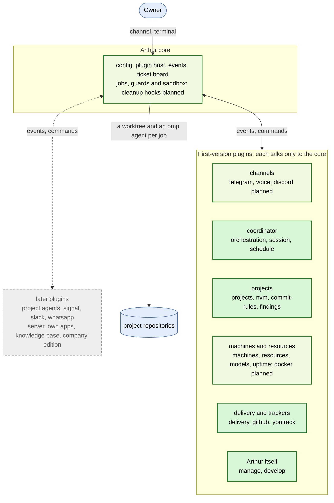

# Arthur

Arthur lets one human direct many coding agents through one coordinator: the human creates the work, says when it is done and keeps each project's vision; the coordinator, an agent that is always on, starts and follows the jobs. Each job runs the OMP agent in its own Git worktree, on its own branch. A small core runs the jobs and keeps a ticket board in plain files, and plugins switch on everything else from one TypeScript config, `arthur.config.ts`. Arthur exposes nothing to the internet.

## What Arthur is

In short; the whole of it is [`spec/vision.md`](spec/vision.md).

- One human directs many agents through one coordinator, who does not read code. The human talks to it through a channel plugin (Telegram today, Discord planned) or from the terminal (`arthur attach`).
- Work happens in isolated worktrees, on their own branches, on this machine or on another one reached over SSH on a private network.
- Plain files in Git and in the home folder `.arthur/` are the truth: tickets, the board, job records. No database.
- One config file, `arthur.config.ts`: the plugins, their options and every project. No secret in it: an option ending in `Env` names a variable, whose value stays in the shell or the env file.
- A small core with a line budget, and plugins that talk to each other only through it. It runs on a VPS as one process and needs Node and OMP, no runtime dependency.

## What Arthur is not

- A hosted service, accounts, or a marketplace of third-party plugins.
- Anything that listens on a public address: every plugin calls out or talks to a local process.
- A mode without a coordinator, or a project list outside the config.
- Another agent runtime: OMP only, not Claude Code or Codex.
- Config in JSON or YAML, or a secret inside the config.

## Status

**Status: in use on its own repository** (main on 2026-10-25). Arthur takes its own tickets: it runs on its owner's VPS as a systemd service, with Telegram as its channel, and each ticket goes from its worker through a review and CI to its merge. [`docs/setup.md`](docs/setup.md) sets one up, each step with the command that checks it, such as `arthur config check`. Other projects follow; the order of the rest is [`spec/roadmap.md`](spec/roadmap.md), and the state of each entry is the board, [`spec/build.json`](spec/build.json).

Next: an agent per project, with its own chat (roadmap entries 85 to 88), then the other plugins in the roadmap's order.

## Features

One line per package; each links the pages with the detail. `arthur help` lists every command, and `arthur <command> --help` prints its page.

- **core**, built: the config and the env file, the plugin host and its event log, `arthur run`, jobs in worktrees with time, money, CPU and memory limits, here or over SSH, the ticket board, the env guard, worktree guard and sandbox of every job, `arthur doctor` and `arthur setup` ([commands](packages/core/docs/commands/), [plugin API](docs/plugin-api.md), [threat model](docs/deploy.md#threat-model)).
- **orchestration**, built: the coordinator, `arthur attach`, `/board`, `/task`, planning, autopilot, the decision log, silent mode and the morning report ([commands](packages/orchestration/docs/commands/)).
- **projects**, built: the project list, each worktree's install, `arthur init` and onboarding ([projects](packages/projects/docs/commands/projects.md), [init](packages/projects/docs/commands/init.md)).
- **session**, built: compaction, a fresh start at night, `/restart` and the restart guard ([session](packages/session/docs/session.md)).
- **schedule**, built: messages and jobs at set times, and entries other plugins register ([schedule](packages/schedule/docs/commands/schedule.md)).
- **machines**, built: other machines for jobs, their labels and checks, and each job placed by labels ([machines](packages/machines/docs/commands/machines.md)).
- **resources**, built: caps per job and per feature, and room for a job by free CPU, memory and disk ([resources](packages/resources/docs/resources.md)).
- **models**, built: model providers on the private network, a fallback list per role, `arthur usage` ([models](packages/models/docs/models.md)).
- **nvm**, built: each project's Node version from its `.nvmrc` ([nvm](packages/nvm/docs/nvm.md)).
- **commit-rules**, built: a commit-message hook, words or a file per project ([commit-rules](packages/commit-rules/docs/commit-rules.md)).
- **findings**, built: the `findings.md` format, and what a merge makes of open findings ([findings](packages/findings/docs/findings.md)).
- **uptime**, built: each project's sites checked over HTTP, a notice when one goes down and when it is back ([uptime](packages/uptime/docs/uptime.md)).
- **telegram**, built: text, media and the phone menu ([telegram](packages/telegram/docs/telegram.md)).
- **delivery**, built: review, `review-needed`, merge with the checks on main, `take-main`, the hand-back after a FAIL, the changelog, auto-merge ([commands](packages/delivery/docs/commands/)).
- **github**, built: CI runs, reruns, pushes and pull request reviews ([github](packages/github/docs/github.md)).
- **youtrack**, built: issues, articles, comments and attachments, and the rules for a job on an issue ([youtrack](packages/youtrack/docs/commands/youtrack.md)).
- **manage**, built: health, stats, the audit, the retro and the daily prune ([manage](packages/manage/docs/manage.md)).
- **develop**, built: `arthur plugin new` and `arthur eval` with its scenarios ([develop](packages/develop/docs/develop.md)).
- **voice**, built: voice notes and audio files transcribed on this server by whisper.cpp, and `arthur transcribe` ([voice](packages/voice/docs/voice.md)).
- Planned: project agents, discord, docker and the core's cleanup hooks; later signal, slack, whatsapp, a server, a web panel and mobile app over Tailscale, a knowledge base and a company edition ([roadmap](spec/roadmap.md)).

What Arthur is built from: green is built, light green partly built, grey planned. The full picture is [the diagram](https://kacperadler.github.io/arthur/diagram/), drawn from [`arthur.mmd`](arthur.mmd).



## Try it

Development needs Node 24: `npm ci`, then `npm run check` and `npm test`.

To run Arthur in a clone after `npm ci`, with `node_modules/.bin` on your `PATH`, write an `arthur.config.ts` (Git ignores it) with the two plugins that need nothing else:

```ts
import { defineConfig } from "@arthur/core";
import { orchestration } from "@arthur/orchestration";
import { projects } from "@arthur/projects";

export default defineConfig({
	plugins: [orchestration({}), projects({ list: [{ name: "arthur", prefix: "AR", path: "." }] })],
});
```

Then `arthur config check`, `arthur projects` and `arthur board` answer at once. `arthur run` starts the coordinator, which needs tmux and OMP, and `arthur attach` opens it. [`docs/setup.md`](docs/setup.md) sets Arthur up on a VPS as a systemd service, step by step.

## Read more

- What Arthur is and is not, in full: [`spec/vision.md`](spec/vision.md).
- The order of the work: [`spec/roadmap.md`](spec/roadmap.md); the board: [`spec/build.json`](spec/build.json).
- Setting it up on a VPS, each step with its check: [`docs/setup.md`](docs/setup.md); other machines for jobs, the threat model, daily use and updating: [`docs/deploy.md`](docs/deploy.md).
- Writing a plugin, and what it may use of the core: [`docs/plugin-api.md`](docs/plugin-api.md).
- An example config with every plugin, planned ones included: [`arthur.config.example.ts`](arthur.config.example.ts).
- Diagrams (Mermaid): [what Arthur is built from](arthur.mmd), [core and plugins](docs/architecture/core-and-plugins.mmd), [from config to a running plugin](docs/architecture/config-flow.mmd), [versions](docs/architecture/versions.mmd).
- Contributing: [`CONTRIBUTING.md`](CONTRIBUTING.md).

## Licence

[Apache-2.0](LICENSE). Arthur is open source: you may use, change, fork and sell it under the Apache License 2.0. The name "Arthur" and the Arthur logo are not licensed with it; they stay Kacper Adler's (see [`NOTICE`](NOTICE)). Contributions are welcome under the same licence, each commit signed off under the Developer Certificate of Origin (see [`CONTRIBUTING.md`](CONTRIBUTING.md)).
