# Arthur

Arthur lets one human direct many coding agents through one coordinator: the human creates the work, says when it is done and keeps each project's vision; the coordinator, an agent that is always on, starts and follows the jobs. Each job runs the OMP agent in its own Git worktree, on its own branch. A small core runs the jobs and keeps a ticket board in plain files, and plugins switch on everything else from one TypeScript config, `arthur.config.ts`. Arthur exposes nothing to the internet.

## What Arthur is

From [`spec/vision.md`](spec/vision.md):

- One human directs many agents through one coordinator, who does not read code. The human talks to it through a channel plugin (Discord, the owner's pick, or Telegram, whichever the config turns on) or from the terminal, in the coordinator's own session (`arthur attach`).
- Work happens in isolated worktrees, on their own branches, on this machine or on another one reached over SSH on a private network.
- Plain files in Git and in the home folder `.arthur/` are the truth: tickets, the board, job records. No database.
- One config file, `arthur.config.ts`: the plugin list, each plugin with its options, and every project. It holds no secret: an option ending in `Env` names the variable that holds it, and the value stays in the shell or `.env`.
- A core that stays small enough for one person to understand, with a line budget, and plugins that talk to each other only through the core.
- It runs on a VPS as a process. Running it needs Node and OMP, no runtime dependencies.

## What Arthur is not

- A hosted service, accounts, or a marketplace of third-party plugins. Plugins are packages the owner installs and lists in the config.
- Anything that listens on a public address: no webhooks, no public endpoint. Every plugin calls out (Telegram and GitHub are polled, Discord's gateway is an outbound connection) or talks to a local process.
- A mode without a coordinator, or a project list outside the config.
- Another agent runtime: Claude Code, Codex and others are not supported; OMP only.
- Config in JSON or YAML, or a secret inside the config.
- Closed source: it is open source under Apache-2.0 (see [Licence](#licence)).

## Status

**Status: in development, not usable yet** (main on 2026-10-18). The core runs, from `arthur config check` to jobs in their own worktrees, and the coordinator starts in its tmux session, reads its context on every turn (the boards, the visions, the jobs not ended by state), hears through its inbox when a job ends, and answers in one reply everything since its last one, a message that arrives mid-turn included; but no channel reaches it yet, and nothing reviews or merges. The order of the rest is [`spec/roadmap.md`](spec/roadmap.md).

What works today:

- The core, roadmap entries 1 to 22, all merged: config and `.env`, the plugin host, events and commands, `arthur run`, jobs on this machine or another one with their time and money limits inside one CPU and memory slice for all jobs, their states, stop, continue and steer, the ticket board, and the env and worktree guards in every job. Entry 93: every option of the core and of each plugin in one table with its meaning and default, which its check walks, and the tools each package runs (`./options` of each package). Entry 94: `arthur setup`, one report of the tools and their versions, what the config sets, what `arthur doctor` finds missing, the installed plugins that could still go in, and the next steps in order.
- The coordinator (`@arthur/orchestration`, entries 23 to 29, 96 and 97): one `omp` in its own tmux session while `arthur run` runs, started again when it ends; `arthur attach`; `/board` and `/task`; an inbox that wakes it when a job ends and takes a human's message mid-turn; its context on every turn (`arthur coordinator context`): its role, each project's vision and board, the jobs not ended by state, the time; a `notice` for the channels when a job asks the owner a question; `maxAgents` across all projects, and each role's model; a large ticket (`- Plan: yes`) planned by a read-only planner, its plan filed with `arthur ticket file`, shown with `/plan`, and a worker refused until the owner approved that plan; a small bug or cleanup ticket from a finding or an audit pre-approved by policy (`arthur ticket status <id> planned --autopilot`), so it runs overnight; every decision it asks the owner for, and his answer, kept in each project's `spec/decisions.jsonl` (`arthur decision`, `arthur decisions`), the answer also a dated line under the ticket's Decisions, and the questions still open in its context; a class of questions the owner always answers the same way, proposed from those answers with the agreement rate of the coordinator's recommendations, which once he approves it answers its questions by policy until he revokes it (`arthur decision class`, `arthur decisions --classes`).
- The project list (`@arthur/projects`, entries 41 and 42): every project in `arthur.config.ts`, `--project <name>` on any command, and each new worktree's dependencies installed; `arthur init` gives a new repository its vision and criteria skeletons, an `.nvmrc` and an empty board, and an onboarding job reads it, asks the owner up to 10 questions and drafts its vision and criteria.
- The coordinator's conversation (`@arthur/session`, entries 35 to 37): compacted at each `compactAt` time once the coordinator is idle, and started fresh at `freshAt` once no job runs (tried every `freshRetryMinutes` until `freshUntil`), each after a handoff it writes and the next conversation reads first; `/restart` and `/restart fresh`, refused while a job runs, which end `arthur run` too while a restart is due, so its service starts it on the new code, and one `Restarted.` notice after; the restart guard: once a commit changed the code `arthur run` loaded, every spawn and continue is refused (unless `--ignore-restart`) until `arthur run` starts again, and the coordinator's context says so.
- The machines (`@arthur/machines`, entries 30 and 31): the other machines jobs run on, with their labels, each checked over SSH at start and every `check.everySeconds` (private address, `arthur version`, os and arch against its labels), `machine-online` and `machine-offline` on each change, and `arthur machines`; each job placed on a machine with the labels it needs (`arthur spawn --requires`, else its ticket's, else its project's), online and under its `maxJobs`, with the fewest jobs.
- The schedule (`@arthur/schedule`, entries 39 and 40): entries in `arthur.config.ts`, in a JSON file and registered by other plugins from their options (ids `<plugin>.<id>`), each a daily time (on some days) or a one-off date and time, that send the coordinator a message, with a procedure's text under it, or spawn a job; `arthur run` runs each due slot once, a slot missed while it was down once and saying it is late, and names a hand-broken entry while the others still run; `arthur schedule` lists every entry with its source and next run, and `add` and `remove` change the file's.
- Commit rules (`@arthur/commit-rules`, entry 43): each project's `commitRules`; a `regex`, checked at load, becomes a `commit-msg` hook in the project's job worktrees that refuses a subject it does not match and says the rule (a merge passes; the project's own hooks still run); `words`, or a `file` read from the repository at the job's commit, go into the worker's and the reviewer's prompt.
- The models (`@arthur/models`, entry 82): named providers, Ollama or OpenAI-compatible servers on loopback, private or Tailscale addresses; a role's or a spawn's model as an ordered list (`arthur spawn --model a,b`), of which each job gets the first available, probed from the job's machine, the record saying which and why; a job on a provider model gets it in its own environment only and costs 0; `arthur usage` and `/usage`, each account's limit windows, which skip a model at `limits.stopAt` and warn at `limits.warnAt`; `arthur doctor` lines for each provider and listed model.
- Each project's Node (`@arthur/nvm`, entry 84): a job whose worktree has `.nvmrc` runs on the Node it names, which `nvm which` finds on the job's machine and which goes first on the job's `PATH`, its install's too (`nvm()` listed before `projects`, else the load is refused); a version not installed there refuses the spawn with its `nvm install`, nothing downloaded; `arthur doctor` says whether nvm is on each machine.
- Uptime (`@arthur/uptime`, entry 98): each project's sites checked over plain HTTP while `arthur run` runs, no model called; a site is down after 2 failed checks in a row (no answer in time, refused, a TLS error, a wrong status, the text missing), told once in a notice with its URL, the reason and since when, and once more with how long when it answers; `uptime-down` and `uptime-up` on the event stream; no site answering is one notice that this machine looks offline, not one per site; what is down survives a restart.
- Findings (`@arthur/findings`, entry 83): the `findings.md` format, out of the core, in every worker's prompt; at `arthur merge` each open entry of the merged ticket settled as its project's `mode` says: `ticket` (the default), a planning ticket each, its Description the finding, its kind, its `budget` and its `Source: F<n> of <id>` line filled in; `grouped`, one planning ticket for them all; `summary`, none, each `deferred (client summary)` and listed in the outcome for the client; an entry already ticketed, fixed, dropped or deferred left alone, and `findings.md` written whole once; `/findings` and `arthur findings`, moved here from orchestration.
- Review jobs (`@arthur/delivery`, entry 52): `arthur review <worker job>` starts a read-only review of a worker's branch at its tip, on the reviewer role and the review criteria, in a fresh session on `roles.reviewer`'s model; its task names the ticket, so placement reads the ticket's labels; the verdict, `PASS` or `FAIL` alone on the last line, moves the ticket to done or back to in-progress, and no verdict fails the review; `arthur ticket file` writes the next `review-N.md`, never twice; a branch gets at most 2 FAILs since its last PASS, then a review needs `--round N` on the owner's word, and the coordinator gets the procedure for his choice.
- Review or no review (`@arthur/delivery`, entry 53): `arthur review-needed <worker job>` decides whether a branch needs a review: always for a file on the always-review list (`review.alwaysReview`, by default what reads secrets, the CI-failure handling and the review rules), a deleted file or `.env` in the diff; never for docs only; for 30 lines or fewer, by the job's own `npm run check` and `npm test` runs, which delivery's extension records while the agent works (`host.jobs.registerExtension`), `stale` after a later edit; `no review` moves the ticket to done, and autopilot asks the same list.
- Merge (`@arthur/delivery`, entry 54): `arthur merge <job>` merges a branch whose tip has a PASS, or one `arthur review-needed` waved through, into main, `--unreviewed` only on the owner's word; refused, main untouched, for a dirty main, a ticket not in progress, or any `merge.check` answer (the projects plugin's for an onboarding); a conflict aborts it; the install of a changed lockfile and the project's `npm run check` and `npm test` run on main, and a failed one resets main, naming it; then the reviews are filed, the findings go to `findings.onMerge` (the findings plugin; without it left open, said once), `outcome.md` is written, the ticket is merged, and the procedure after a merge names what the coordinator does next.
- Hand-back after a FAIL (`@arthur/delivery`, entry 55): while `arthur run` runs, a FAIL review is filed, its worker continued with the findings and a new budget (its budget again on top of what it spent) through `host.jobs.continue`, and the next review started when the worker's run finishes; each step goes through every `beforeSpawn`, so `maxAgents` holds, and one refused waits for the next end of a run instead of being dropped; the second FAIL since the last PASS stops at the review limit with its procedure; `/stopall` cancels every hand-back, and stops a continue or review starting as it comes.
- Changelog (`@arthur/delivery`, entry 56): `arthur changelog` writes a project's `CHANGELOG.md` from its merged tickets, one section per merge day, newest first, and under it Added, Fixed, Changed and Other by each ticket's kind (a ticket without one under Other), each line its id, title and merge commit; the same board gives the same file byte for byte; `arthur merge` rebuilds it after every merge that went in, and the commit after the merge takes it along.
- Auto-merge (`@arthur/delivery`, entry 59): `arthur merge <job> --auto` merges without the owner only in a project with `autoMerge: true`, with a PASS on the tip itself, no held path in the branch (a role, the vision, the CI workflows, any `package.json`, the always-review list; both names of a renamed file), and CI passed on a commit of the branch, asked of the github plugin through `github.ci`; each refusal names its rule, and `--no-ci` leaves CI out on the owner's word only. CI not passed yet leaves a wait: while `arthur run` runs, the run's end wakes the coordinator with its verdict once per run attempt, across a restart too, and a run still going 30 minutes after its start is cancelled through `github.cancel`.
- GitHub CI runs (`@arthur/github`, entries 57 and 58): every `poll.everySeconds` the newest runs of each project's `ci.workflow`, read with the token of the instance named after the repository's owner (else the unnamed one); each branch in play (the checkout's own and every job's) gets the run of its nearest commit that has one, so a commit outside the workflow's paths counts the run before it; `ci-finished` once per run attempt, across a restart too, a rerun's end included, waking the coordinator when `wakeOn` names it; a refused token said once, not every poll; a rate limit waits as GitHub says. `arthur ci <branch>` tells why the run that built a branch failed (each failed job and step, the end of its log), `--rerun` reruns a failed or cancelled run once; a branch a review passed and main after `arthur merge` are pushed to origin, one warning line when that fails, never a prompt; with `pull-request-review` in `wakeOn`, the reviews of open pull requests are told once each.
- Health (`@arthur/manage`, entry 60): `arthur health` and `/health`, one line per thing that should have happened by now and has not, from every plugin's answer to `health` and manage's own checks (a ticket in progress or review with no job for an hour, main not pushed for an hour, the board uncommitted for an hour, a finished audit or retro not filed for an hour, the temporary folder or a filesystem's inodes under 10% free), a provider that throws costing its own line only; reads only; with `health.everyMinutes`, `arthur run` sends each round's new lines as one notice, a problem the round before saw never twice in a row, across a restart too.
- Stats (`@arthur/manage`, entry 61): `arthur stats`, per merged ticket of a project its review rounds and verdicts, its cost from `outcome.md` and its days from made to merged; the mean rounds over the reviewed tickets, the share of first-round PASS, the share pre-approved by autopilot, the 3 most expensive, and the first line of each finding of a FAIL review; a missing cost counts as unknown, never zero.
- The audit (`@arthur/manage`, entry 62): the kind `audit`, read-only on the auditor role and the audit criteria, its prompt the commits since the last audit (a commit of only the reports and the board left out), the board digest, the stats since then, the open findings and the vision's path; up to 5 proposals or `NO PROPOSALS`; `arthur ticket file <job>`, with no ticket, files it as `spec/quality/<date>.md` (`-2.md` for a second that day) with the commit audited, never a failed one; one resume at its budget, doubled; with `audit.at` and `audit.days` the schedule runs `manage.audit`, which starts no job on another day or with no commit since the last audit; the procedure its end brings.
- The retro (`@arthur/manage`, entry 63): the kind `retro`, read-only on the retro role and the retro criteria, its prompt the merges since the last retro with each merged ticket's outcome, FAIL reviews and findings to read, the stats since then, the board digest, and the role files, procedures and criteria the plugins ship; `arthur retro-due`, due at 10 merges with 2 FAIL reviews or 5 findings, its line in the coordinator's context on every turn; `arthur ticket file <job>` files it as `spec/retro/<date>.md` with the commit it looked back from, and its phone page `spec/retro/<date>.html`; `/retro` sends the newest page through the channel it came from; with `retro.day` and `retro.at` the schedule runs `manage.retro` weekly, which starts no job while none is due; the procedure its end brings.
- The daily prune (`@arthur/manage`, entry 64): with `prune.keepJobsDays`, the schedule plugin runs manage's entry `manage.prune` each day at 03:00, and once at the next start when `arthur run` was down then: every job that ended that many days ago is freed as `arthur prune` does it (`host.jobs.prune`), and each `arthur-*` folder of the temporary folder changed last more than a day ago is removed, never one made since a running job's run began, a link never followed, one another user owns kept with a line; without the schedule plugin the option refuses the load.
- New plugins (`@arthur/develop`, entry 66): `arthur plugin new <name> --budget <lines>` makes `packages/<name>/` in Arthur's own checkout, or, run by a job, only in its own worktree given as `--root`, its `package.json`, a plugin file that is its options file too, a test against the fake host and a doc page, adds its line budget to `test/structure.test.ts` and the workspace to `package-lock.json`, and the result passes `npm run check` and `npm test` as created; a bad or taken name, a budget missing, not a positive whole number or below the new source's lines is refused before any file is written.
- The morning report (`@arthur/orchestration`, entry 65): with `morningReport.at`, orchestration registers `orchestration.report` with the schedule plugin, an action that sends the coordinator its procedure each day at that time: built overnight, merged without the owner, waiting for approval, waiting for a decision, and needs attention from `arthur health`, each section left out when empty, a night with nothing done in one line; every ticket, job or finding named gets a plain sentence, every decision a self-contained question with options and a recommendation; without the schedule plugin the option refuses the load.
- Evals (`@arthur/develop`, entry 67): `arthur eval` replays one coordinator turn per run, an owner's message, a schedule entry due or a job's end with its wake, against the scenarios each package keeps in `evals/<name>/`, on a fresh Git copy of the scenario's fixture with `arthur` a recording stub that writes only in that copy; each run is scored only by the files, refs and stub calls it left behind, a turn past its timeout fails, a scenario without its fixture fails alone; pass rates are compared with the baseline in the checkout, the moved scenarios named. Every `arthur` command refuses inside an eval session (`ARTHUR_EVAL`). The scenarios themselves are entry 68.

What is next:

- An agent per project, with its own chat (entries 85 to 88, the plan of AR0098); then the other plugins, in the roadmap's order.

## Features

Each feature and its state on main on 2026-10-18, read from `packages/` and `spec/build.json`: built when every roadmap entry it needs is merged, in progress when some are, planned when none is.

| Feature | State | Roadmap entries |
| --- | --- | --- |
| Repository rules as a test: line budgets, no runtime dependency, plugin boundaries | built | 1 |
| Config, `.env` and `arthur config check` | built | 2, 3 |
| Plugin host, event stream, command registry, `arthur run` | built | 4 to 6, 8 |
| Clock: time zone and quiet hours | built | 7 |
| Jobs: spawn, the wrapper, time and budget limits, one systemd scope per job, stop, continue, steer, list, prune, job state | built | 9, 11 to 16 |
| Roles and prompts, `arthur roles` | built | 10 |
| Ticket board: tickets, statuses, `after`, the digest | built | 17, 18 |
| Env guard and worktree guard, for every project's checkout | built | 19, 20 |
| Jobs on another machine over SSH | built | 21, 22 |
| Test kit: the fake host and the fake agent | built | 4, 11 |
| Core: `arthur doctor`, checked at every start | built | 80 |
| Core: `arthur setup`, and every option's meaning beside its check | built | 93, 94 |
| Core: `arthur send` and the message parts every channel hands over | built | 49 |
| Core: cleanup hooks with each worktree | planned | 71 |
| Core: the frozen plugin API, written down in [docs/plugin-api.md](docs/plugin-api.md) | built | 51 |
| orchestration: the coordinator, `arthur attach`, `/board`, `/task`, `/plan`; its inbox, context, jobs by state, `maxAgents`, planning, autopilot, decision log and classes, morning report | built | 23 to 29, 65, 96, 97 |
| orchestration: an agent per project, with its own chat | planned | 85 to 88 |
| projects: the project list and each worktree's install; `arthur init` and onboarding a repository | built | 41, 42 |
| session: compaction, fresh start, `/restart`, restart guard, start notice and LLM probe | built | 35 to 38 |
| schedule: actions and jobs at set times, registered entries, `arthur schedule` | built | 39, 40 |
| machines: the list, labels and SSH checks, `arthur machines`; placing each job by labels | built | 30, 31 |
| resources: caps per job and per feature, free CPU, memory and disk | built | 32 to 34, 69 |
| models: providers on other machines, a fallback chain, `arthur usage` | built | 82 |
| docker: labels, cleanup with each worktree, the leftover sweep | planned | 70 to 72 |
| nvm: each project's Node version | built | 84 |
| commit-rules: a regex hook, words or a file per project | built | 43 |
| uptime: each project's sites checked over HTTP, a notice when one is down and when it is back | built | 98 |
| findings: the `findings.md` format, `/findings`, and what a merge makes of open findings, per project | built | 83 |
| telegram: text, media and the phone menu; the coordinator's silent mode (`/silent`), which every channel follows | built | 47 to 50 |
| discord: one private server, a main channel for the coordinator and one per project; text, media, phone commands | planned | 89, 90 |
| voice: local transcription of voice notes | planned | 81 |
| delivery: review, merge, hand-back after a FAIL, changelog, auto-merge | built | 52 to 56, 59 |
| github: CI runs, reruns, pushes, pull request reviews | built | 57, 58 |
| youtrack: issues, articles, comments, attachments, the rules for jobs on an issue | built | 44 to 46 |
| manage: health, stats, audit, retro, prune on a schedule | built | 60 to 64 |
| develop: `arthur plugin new`, evals | in progress, 2 of 3 entries | 66, 67 built; 68 |
| Later: signal, slack and whatsapp channels; server, web panel and the owner's mobile app (Expo) by the VPS's Tailscale name; knowledge base; company edition | planned | 73 to 79, 91, 92, 95 |

## Commands

The commands that exist today, one line each; `arthur <command> --help` prints its page.

- `arthur help [<command>]`: every command's name, or one command's page.
- `arthur config check`: loads `arthur.config.ts` and lists every env variable the enabled plugins need, `set` or `missing`, never its value.
- `arthur run`: runs Arthur as a process: starts the plugins, delivers the events, and stops them on SIGTERM; one process per home folder.
- `arthur spawn <task>`: starts a job from HEAD on its own branch and worktree, its agent in the background, and prints its id.
- `arthur jobs` (`/jobs`): every project's jobs, grouped by state, one line each.
- `arthur stop <id>`: stops a job in a run, and every process it started.
- `arthur stopall` (`/stopall`): stops every job in a run, of every project.
- `arthur steer <id> <text>` (`/steer`): one correction, which the job's agent gets after its next tool call.
- `arthur continue <id> <instruction>`: resumes an ended or blocked worker in place: same id, branch, worktree and session.
- `arthur prune (<id>... | --all)`: frees the worktree, branch and record of ended jobs, as far as Git finds it safe.
- `arthur roles`: every role, its model, and the files its prompt reads.
- `arthur ticket new|status|after|file`: creates a ticket, moves it to another status, sets the tickets it waits for, or files a finished job's final message, in its ticket's folder or, for an audit, in `spec/quality/`, and for a retro in `spec/retro/` with its phone page.
- `arthur version`: the version of the core, which a machine that runs jobs must match.
- `arthur remote-job`: the half of a job on another machine that runs there; Arthur runs it over SSH, a person has no reason to.
- `arthur attach` (orchestration): attaches this terminal to the coordinator's tmux session.
- `arthur coordinator stop|context` (orchestration): `stop` ends the coordinator's session until `arthur run` starts again, refused while a job runs; `context` prints what the coordinator reads before every turn.
- `arthur silent [on '<work>' | off | ask]` (`/silent`, orchestration): the silent mode, for delegated work: while it is on, the owner hears only the end of the work, a decision and the answers to his own messages; `off` sums up what happened meanwhile.
- `arthur decision ask|answer|close` (orchestration): records a decision the coordinator asks the owner for, his answer, or why it no longer applies, in the project's decision log; `class propose|revoke` proposes a class of decisions the owner answers the same way, which his approval lets answer by policy, or revokes it; refused inside a job.
- `arthur decisions [<words>] [--open] [--kind <kind>] [--ticket <id>]` (orchestration): lists and searches the decision log; `arthur decisions <id>` prints one question whole; `--classes` lists the classes.
- `arthur board [PREFIX] [all]` (`/board`, orchestration): a project's ticket board, one line per ticket.
- `arthur task <id>` (`/task`, orchestration): a ticket's status and its `ticket.md`.
- `arthur findings <id>` (`/findings`, findings): a ticket's `findings.md`, from its worker's branch before the merge.
- `arthur projects` (`/projects`, projects): every project, its folder, its open tickets and its install.
- `arthur init <project>` (projects): gives a project's repository without a board what Arthur reads: the vision and criteria skeletons, an `.nvmrc` and an empty board.
- `arthur machines` (`/machines`, machines): every machine, its labels, online or why not, and its jobs.
- `arthur restart [fresh]` (`/restart`, session): restarts the coordinator after its handoff, with `--continue` or, with `fresh`, in a new conversation, and `arthur run` too under its service while a restart is due; refused while a job runs.
- `arthur resources [<ticket>]` (`/resources`, resources): each machine's room for more jobs from its free CPU and memory; with a ticket, what all its jobs spent against its caps per feature.
- `arthur usage [--email]` (`/usage`, models): each account's limit windows from the agent's report, used % and when each resets.
- `arthur review <worker job> [--round <n>]` (delivery): a review of an ended worker's branch at its tip, its verdict moving the ticket; in `arthur run` a FAIL is handed back to the worker and reviewed again at its end; refused after 2 FAILs since the branch's last PASS until the owner's word gives `--round`.
- `arthur review-needed <worker job>` (delivery): whether an ended worker's branch needs a review, by the first rule that holds (the always-review list, a deleted file, `.env`, docs only, 30 lines, the job's own checks); `no review` moves the ticket to done.
- `arthur merge <job> [--unreviewed | --auto [--no-ci]]` (delivery): an ended job's branch merged into main once its tip has a PASS (or on the owner's word), every `merge.check` answer heard first; install and the project's checks on main, which a failed check resets; then its reviews filed, its findings handed to `findings.onMerge`, `outcome.md` written, the ticket merged and the tickets it unblocks named. `--auto`: only with `autoMerge` on, a PASS on the tip, no held path and CI passed.
- `arthur ci <branch> [--rerun]` (github): the run that built a branch, as the poll finds it, and why it failed: each failed job and step and the end of its log; `--rerun` reruns a failed or cancelled run, once per run.
- `arthur health` (`/health`, manage): one line per thing that should have happened by now and has not, from every plugin's health checks and manage's own, or one line saying nothing is wrong.
- `arthur stats [--project <name>]` (manage): per merged ticket its review rounds, verdicts, cost and days, then the mean rounds, the share of first-round PASS and of autopilot, the 3 most expensive and the first line of each FAIL finding.
- `arthur retro-due [--project <name>]` (manage): whether a retro is due, 10 merges since the last retro with 2 FAIL reviews or 5 findings in them, as one line naming the counts.
- `arthur retro [--project <name>]` (`/retro`, manage): the newest retro's phone page, its path; `/retro` sends it as a file.
- `arthur plugin new <name> --budget <lines>` (develop): a new plugin package in Arthur's checkout, or in a job its own worktree (`--root`), with its line budget and workspace added, that passes `npm run check` and `npm test` as created.
- `arthur eval [<scenario>...] [--runs <n>] [--save-baseline]` (develop): replays coordinator turns against the scenarios of the loaded packages, each on a copy of its fixture with `arthur` a recording stub, scores each run by the files, refs and stub calls it left behind, and names the scenarios whose pass rate moved against the baseline.
- `arthur youtrack issue|article list|get|create|update|move|attachments|delete`, `issue set|tag|untag|links|link|unlink|work`, `issue work list|edit|delete`, `comment list|add|edit|delete`, `attachment add|delete` (youtrack): a project's YouTrack issues and articles with their comments and attachments, read, written and deleted on the instance its `tracker` picks; open issues grouped by state, searched with `--query`, custom fields, tags, links, work items, sub-articles, and attachments saved to `.arthur/youtrack/<id>/`.

## Try it

Development needs Node 24: `npm ci`, then `npm run check` and `npm test`.

To run what exists, in a clone after `npm ci`, with `node_modules/.bin` on your `PATH`, write an `arthur.config.ts` (Git ignores it) with the only two plugins built so far:

```ts
import { defineConfig } from "@arthur/core";
import { orchestration } from "@arthur/orchestration";
import { projects } from "@arthur/projects";

export default defineConfig({
	plugins: [orchestration({}), projects({ list: [{ name: "arthur", prefix: "AR", path: "." }] })],
});
```

Then `arthur config check`, `arthur projects` and `arthur board` answer at once. `arthur run` starts the coordinator, which needs tmux and OMP, and `arthur attach` opens it. [`docs/setup.md`](docs/setup.md) sets it up on a VPS as a systemd service, step by step; [`docs/deploy.md`](docs/deploy.md) adds other machines for jobs and the threat model.

## Read more

- What Arthur is and is not, in full: [`spec/vision.md`](spec/vision.md).
- The order of the work: [`spec/roadmap.md`](spec/roadmap.md); the board: [`spec/build.json`](spec/build.json).
- Diagrams (Mermaid): [core and plugins](docs/architecture/core-and-plugins.mmd), [from config to a running plugin](docs/architecture/config-flow.mmd), [versions](docs/architecture/versions.mmd).
- Writing a plugin, and what it may use of the core: [`docs/plugin-api.md`](docs/plugin-api.md).
- An example config with every plugin, planned ones included: [`arthur.config.example.ts`](arthur.config.example.ts).
- Setting it up on a VPS, each step with its check: [`docs/setup.md`](docs/setup.md); other machines for jobs, the threat model, daily use: [`docs/deploy.md`](docs/deploy.md).
- The licence: [`LICENSE`](LICENSE), [`NOTICE`](NOTICE); contributing: [`CONTRIBUTING.md`](CONTRIBUTING.md).

## What Arthur is built from

Which parts are built today and which are planned. The source is [`arthur.mmd`](arthur.mmd); a test keeps this copy equal to it.

```mermaid
%% What Arthur is built from, and what of it is built: the state of main on 2026-10-22.
%% Status read from packages/ and spec/build.json: a roadmap entry counts as built when its ticket is merged.
%% Core entries 1-22, 51, 80, 93 and 94 are merged, of 1-22, 51, 71, 80, 93 and 94; orchestration has entries 23 to 29, 65, 96 and 97 of 23-29, 65, 96 and 97; projects has entries 41 and 42 of 41-42; machines has entries 30 and 31 of 30-31; resources has entries 32 to 34 and 69 of 32-34 and 69; session has entries 35 to 38 of 35-38; schedule has entries 39 and 40 of 39-40; models has entry 82 of 82; nvm has entry 84 of 84; youtrack has entries 44 to 46 of 44-46; commit-rules has entry 43 of 43; telegram has entries 47 to 50 of 47-50; uptime has entry 98 of 98; delivery has entries 52 to 56 and 59 of 52-56 and 59; github has entries 57 and 58 of 57-58; manage has entries 60 to 64 of 60-64; develop has entries 66 and 67 of 66-68; findings has entry 83 of 83; no other plugin exists yet.
%% Plugins never call each other: every plugin talks to the core (events, commands, provide/call), and the core to the outside.
%% Also planned, from the approved plan of AR0098: project agents in orchestration, and the slack channel; from AR0134: discord in the first version, and the owner's own apps over Tailscale.
%%{init: {"flowchart": {"wrappingWidth": 400, "nodeSpacing": 30, "rankSpacing": 40}}}%%
flowchart TD
  human([Owner])
  human -.->|phone| tg
  human -.->|phone| dc
  human -->|writes| files
  human -->|shell| terminal

  subgraph CORE[Arthur core: 26 of 27 core entries built]
    files[/arthur.config.ts<br/>.env: secret values/]
    terminal[terminal<br/>arthur CLI, arthur attach]
    loader[config loader<br/>arthur config check]
    run[arthur run<br/>one process per home<br/>arthur doctor at every start]
    commands[command registry<br/>arthur CLI, /name text]
    host[plugin host<br/>provide, call, collect]
    events[event stream<br/>.arthur/events.jsonl]
    clock[clock<br/>time zone, quiet hours]
    board[ticket board<br/>spec/build.json]
    prompts[prompt loader<br/>arthur roles]
    guards[env guard<br/>worktree guard]
    runner[job runner<br/>spawn, limits, stop, steer<br/>state, prune, other machines]
    kit[test kit<br/>fake host, fake agent]
    options[option tables, arthur setup<br/>every option's meaning, each package's tools]
    parts[arthur send, message parts<br/>what every channel hands over]
    api[frozen plugin API<br/>docs/plugin-api.md]
    corelater[later in the core<br/>cleanup hooks]
    files -->|loads| loader
    terminal --> commands
    loader --> host
    run --> host
    commands --- host
    host --- events
    host --- clock
    host --- board
    host --> runner
    prompts -->|role prompt| runner
    guards -->|in every job| runner
    kit ~~~ options ~~~ parts ~~~ api ~~~ corelater
  end

  subgraph PLUGINS[Plugins: each talks only to the core]
    subgraph FIRST[First-version plugins]
      subgraph CHAN[Channels and media]
        telegram[telegram<br/>text, media, phone menu]
        discord[discord<br/>main channel, one per project<br/>text, media, /name text]
        voice[voice<br/>whisper.cpp, on the CPU]
        telegram ~~~ discord ~~~ voice
      end
      subgraph COORD[Coordinator]
        orchestration[orchestration<br/>coordinator, arthur attach<br/>context, jobs by state, planning, autopilot<br/>morning report, decision log, decision classes]
        session[session<br/>compaction, fresh start, restart guard<br/>start notice, LLM probe]
        schedule[schedule<br/>actions, jobs at set times<br/>registered entries, arthur schedule]
        orchestration ~~~ session ~~~ schedule
      end
      subgraph PROJ[Projects]
        projects[projects<br/>project list, install<br/>arthur init, onboarding]
        nvm[nvm<br/>Node version per project<br/>from .nvmrc, on the job's machine]
        commit[commit-rules<br/>regex, words, file]
        findings[findings<br/>findings.md, on merge<br/>per project mode]
        projects ~~~ nvm ~~~ commit ~~~ findings
      end
      subgraph RES[Machines and resources]
        machines[machines<br/>list, labels, SSH checks<br/>places each job by labels]
        resources[resources<br/>caps per job and feature<br/>free CPU, memory, disk]
        models[models<br/>providers, fallback chain<br/>arthur usage]
        docker[docker<br/>labels, cleanup, sweep]
        uptime[uptime<br/>client sites over HTTP<br/>down and up notices]
        machines ~~~ resources ~~~ models ~~~ docker ~~~ uptime
      end
      subgraph DELIV[Delivery and trackers]
        delivery[delivery<br/>review, merge, hand-back, changelog<br/>auto-merge after a PASS and green CI]
        github[github<br/>polls CI runs, PR reviews<br/>arthur ci, reruns, pushes]
        youtrack[youtrack<br/>reads and writes issues, articles<br/>comments, attachments, rules for jobs]
        delivery ~~~ github ~~~ youtrack
      end
      subgraph SELF[Arthur itself]
        manage[manage<br/>arthur health, /health, arthur stats, the daily prune<br/>the audit, the retro, arthur retro-due, /retro]
        develop[develop<br/>arthur plugin new, arthur eval<br/>2 of 3 entries; planned: the eval scenarios]
        manage ~~~ develop
      end
    end

    subgraph LATER[Later plugins]
      agents[project agents<br/>one per project, its own chat]
      signal[signal<br/>a channel, signal-cli]
      slack[slack<br/>a channel, Socket Mode]
      whatsapp[whatsapp<br/>a channel, local bridge]
      server[server<br/>events, commands over HTTP<br/>private network only]
      apps[own apps<br/>web panel, mobile app in Expo<br/>by Tailscale name, no public port]
      knowledge[knowledge base<br/>search, chat with sources]
      company[company edition<br/>business roles as agents]
      agents ~~~ signal ~~~ slack ~~~ whatsapp ~~~ server ~~~ apps ~~~ knowledge ~~~ company
      apps -.->|Tailscale| server
    end
  end

  subgraph OUT[Outside Arthur]
    omp[(omp agent<br/>one per job)]
    repos[(project repositories<br/>a worktree per job)]
    remote[(other machines<br/>SSH, private network)]
    providers[(model providers<br/>private network)]
    dockerd[(Docker)]
    gh[(GitHub)]
    yt[(YouTrack)]
    tg[(Telegram)]
    dc[(Discord)]
    sl[(Slack)]
    sites[(client sites<br/>HTTP, HTTPS)]
  end

  subgraph LEGEND["Legend: state of main on 2026-10-21"]
    direction LR
    lbuilt[green: built<br/>merged, in packages/]
    lpartial[light green: partly built<br/>N of M entries merged]
    lplanned[grey, dashed: planned<br/>not built yet]
    loutside[(blue: outside Arthur)]
    larrows[solid arrow: works today<br/>dotted arrow: planned]
    lbuilt ~~~ lpartial ~~~ lplanned ~~~ loutside ~~~ larrows
  end

  OUT ~~~ LEGEND

  host <-->|events, commands| FIRST
  host <-.->|events, commands| LATER

  runner -->|spawns| omp
  runner -->|worktree, branch| repos
  runner -->|SSH| remote
  projects -->|clones| repos
  models -->|probes| providers
  docker -.->|labels, sweeps| dockerd
  github -->|polls CI runs, PR reviews; reruns| gh
  github -->|pushes reviewed branches, main| repos
  youtrack -.->|reads, writes| yt
  telegram -.->|polls, sends| tg
  discord -.->|gateway| dc
  slack -.->|Socket Mode| sl
  uptime -->|checks| sites

  classDef built fill:#d8f5d8,stroke:#2d7a2d,stroke-width:2px,color:#000;
  classDef partial fill:#f0f9e0,stroke:#2d7a2d,stroke-width:2px,color:#000;
  classDef planned fill:#eee,stroke:#888,stroke-dasharray:5 4,color:#555;
  classDef outside fill:#e3edfa,stroke:#4a6fa5,color:#000;
  class lbuilt,files,terminal,loader,host,commands,run,events,clock,board,prompts,runner,guards,kit,options,parts,api,machines,session,schedule,projects,models,nvm,commit,youtrack,telegram,uptime,github,delivery,findings,resources,manage,orchestration built;
  class lpartial,develop partial;
  class lplanned,discord,voice,corelater,agents,docker,signal,slack,whatsapp,server,apps,knowledge,company planned;
  class loutside,human,tg,omp,repos,remote,providers,dockerd,gh,yt,dc,sl,sites outside;
  style larrows fill:#fff,stroke:#999,color:#000
  style LEGEND fill:#fff,stroke:#999
  style CORE fill:#f2fbf2,stroke:#2d7a2d
  style PLUGINS fill:#fcfcfc,stroke:#777
  style FIRST fill:#f5f5f5,stroke:#999
  style CHAN fill:#fff,stroke:#bbb
  style COORD fill:#fff,stroke:#bbb
  style PROJ fill:#fff,stroke:#bbb
  style RES fill:#fff,stroke:#bbb
  style DELIV fill:#fff,stroke:#bbb
  style SELF fill:#fff,stroke:#bbb
  style LATER fill:#f5f5f5,stroke:#999,stroke-dasharray:5 4
  style OUT fill:#f7f9fc,stroke:#4a6fa5
```



## Licence

[Apache-2.0](LICENSE). Arthur is open source: you may use, change, fork and sell it under the Apache License 2.0. The name "Arthur" and the Arthur logo are not licensed with it; they stay Kacper Adler's (see [`NOTICE`](NOTICE)). Contributions are welcome under the same licence, each commit signed off under the Developer Certificate of Origin (see [`CONTRIBUTING.md`](CONTRIBUTING.md)).
